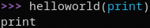

# Hello!
I'm Alex, a student coding in his free time, I mainly code in [Python](python.org) and [HTML](html.spec.whatwg.org), want to learn [Rust](rust.rs), forced to learn C.

## Currently Working On
- Music App based off [shredos67/swiftify](github.com/shredos67/swiftify) 

## Currently Learning
- Python
- HTML
- Rust
- C
- C++

## How to Reach Me
- Reddit
- Instagram
- Comment in any of my comment sections

by the way to make the image - if you didn't know- above you need to make a function that prints "print" when called (in python).
